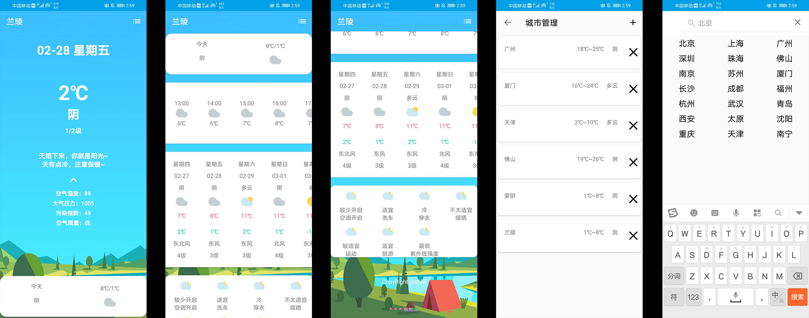

[**English**](README.md) | [简体中文](README.zh-CN.md)

# MiniWeather

[](https://github.com/bestyize/MiniWeather/actions/workflows/android.yml)
[](LICENSE)

A lightweight Android weather app originally created by **亦泽 (Yize)**. MiniWeather displays forecasts and weather details for saved cities, using Tencent Weather web endpoints for weather data.

> **Project status:** The build system was modernized in 2026. The source compiles with current Android tooling, but the legacy weather endpoints and Tencent Location SDK still require real-device and network regression testing. Do not assume the latest debug APK is production-ready.

## Preview



More screenshots: [Weather overview](pic/main_top.jpg) · [Forecast](pic/main_mid.jpg) · [Details](pic/main_last.jpg) · [City management](pic/manage.jpg)

## Features

- Current conditions, temperature, wind, humidity, pressure and air-quality information.
- Hourly and multi-day weather forecasts, plus lifestyle/weather indices.
- Search cities, choose from popular cities, and manage multiple saved locations.
- Local storage of saved city information using SQLite.
- **Optional foreground location:** tap the current-location entry on the city search screen to request access. On Android 12+, approximate location is supported; city search still works if permission is denied.
- Java + Android XML layouts; no Kotlin or Jetpack Compose migration is required to work on the project.

Actual weather and location results depend on external services.

## Android build requirements

| Component | Project configuration |
| --- | --- |
| Android Gradle Plugin | 9.4.0 |
| Gradle | 9.8.2 (Wrapper) |
| Java | JDK 17 |
| Compile SDK | API 37 (Android 17) |
| Target SDK | API 36 (Android 16) |
| Minimum SDK | API 23 (Android 6.0) |
| Android SDK | Platform 37.0; Build Tools 36.0.0 |

Android Studio with support for the Android Gradle Plugin above is recommended. The project uses **Gradle Kotlin DSL** (`*.gradle.kts`) and a **version catalog** (`gradle/libs.versions.toml`) to manage build dependencies.

## Build from source

1. Install JDK 17, the Android SDK platform shown above and a compatible Android Studio version.
2. Clone and open the repository root in Android Studio, or run:

   ```bash
   git clone https://github.com/bestyize/MiniWeather.git
   cd MiniWeather
   ./gradlew :app:assembleDebug :app:testDebugUnitTest :app:lintDebug
   ```

   On Windows, use `gradlew.bat` instead of `./gradlew`.

3. Find the debug APK in `app/build/outputs/apk/debug/`.

The local Android SDK directory can be set with `local.properties` (`sdk.dir`) or an SDK environment variable. **Never commit `local.properties` or signing credentials.**

GitHub Actions also runs debug assembly, JVM unit tests and Android Lint on pushes and pull requests. Successful workflow runs publish a **debug APK artifact**, not a signed production release.

For setup details, compatibility caveats and a device-test checklist, see [BUILDING.md](BUILDING.md) (Chinese).

## Data sources and technical notes

The source code currently uses these Tencent Weather **web endpoints**:

- Weather: `https://wis.qq.com/weather/common`
- City lookup: `https://wis.qq.com/city/like`

The application also uses the Tencent Location SDK, OkHttp, Gson, Glide, AndroidX and AutoBus. The web endpoints are **not guaranteed to be stable or officially supported for third-party applications**. Availability, response formats, images and SDK behavior may change independently of this repository.

For background research, see the [original Chinese API notes](%E8%85%BE%E8%AE%AF%E5%A4%A9%E6%B0%94API.md) and the [archived original README with full example responses](docs/legacy/README-original.zh-CN.md). Those notes are historical examples, **not verified current API specifications**.

## Permissions and compatibility

- Foreground coarse/fine location is requested only when the user chooses to locate their city; manual city search does not require it.
- No background-location or phone-state permission is declared by the app.
- Android 12–17 behavior has been addressed in code, including system-bar insets, keyboard insets and standard back navigation; **device-level regression testing is still needed**.
- Targeting API 36 does **not** guarantee Google Play approval or weather-service availability.

## Contributing

Bug reports and pull requests are welcome via [GitHub Issues](https://github.com/bestyize/MiniWeather/issues) and [Pull Requests](https://github.com/bestyize/MiniWeather/pulls). When reporting a crash or location issue, include the Android version, device model, reproduction steps and relevant logs (without secrets or personal location information).

## License

Licensed under the [Apache License, Version 2.0](LICENSE).

---

[**English**](README.md) | [简体中文](README.zh-CN.md)
